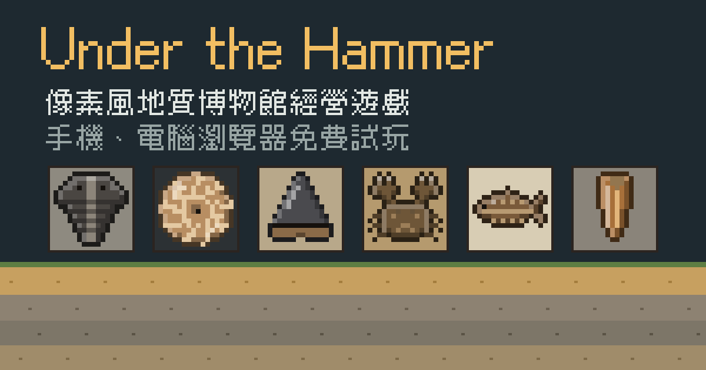

# Under the Hammer

## ▶ [點這裡直接玩](https://l46141111.github.io/Under-the-hammer/)

遊戲網址：https://l46141111.github.io/Under-the-hammer/ （手機、電腦的瀏覽器直接開，不用安裝）

這一頁是遊戲的原始碼。想玩遊戲，請點上面的連結。

像素風的地質博物館經營遊戲。到台灣和世界各地的真實產地敲岩石、找化石和礦物，帶回工坊剖開、清修、切磨，放進展示櫃吸引訪客；也可以出國逛市集，不過攤位上的東西不一定是真的。

整個遊戲是一個 HTML 檔，不需要安裝，用瀏覽器打開就能玩，手機和電腦都可以。

## 特色

- **真實的產地與標本**：台灣的大漢溪、水湳洞、菜寮溪等產地，美國、英國、德國的採集場，還有緬甸和摩洛哥的市集。化石都附上學名（能鑑定到哪一層就寫到哪一層）、地層和年代，資料都查證過來源。
- **野外採集**：體力每天早上恢復，從地表一路往下挖；岩塊上的化石紋路和礦物閃光是線索，天氣也會影響收穫。有紋路的岩塊可以改用鑿子，慢一點但不會敲壞。
- **標本處理**：岩塊要剖開才知道裡面有什麼，化石要清修、寶石要切磨，手不穩可能會弄壞。
- **市集與假貨**：翻模的三葉蟲、染色的翡翠、灌膠的賭石，買之前要看仔細，也可以送鑑定。
- **看得見的博物館**：展示廳裡會有訪客走進來，停在展品前面冒出反應；校外教學整團進場，記者、收藏家也會真的走進來。博物館的星星越多，裝潢越講究。
- **博物館經營**：展示櫃、站在鋼架上的三角龍和鯨魚骨架、星級評鑑、校外教學、記者採訪和每季的特展。
- **市集和網路商店也會動**：建國假日玉市的攤位、曼德勒玉石市場的遮陽傘和手電筒、國外化石店的層架；網路商店有人下單，館長就從架上拿貨打包，等宅配來收件。
- **固定的人物和委託**：退休的地調所技正周伯、玉市攤商阿坤、常來看化石的小柚、大學研究室的林博士，會帶你認識新的產地和系統，也會拜託你找標本。
- **慢慢解鎖**：一開始只有大漢溪和一間小小的博物館，市集、網路商店、東部的礦物產地、出國採集和緬甸賭石，會隨著進度一個一個開放。
- **發現新種**：運氣非常好的話，會剖出一件圖鑑對不上的化石。寄給研究室，等論文發表，它就成了鎮館之寶。（新種的學名是遊戲虛構的。）

## 存檔

進度會自動存在你使用的瀏覽器裡。換手機或電腦時，到「設定 → 匯出」複製存檔代碼或下載存檔檔案，再到新的裝置「匯入」。

## 回報問題

發現 bug，或標本的學名、年代、產地資訊有誤，歡迎開 Issue 告訴我們。

## 授權

- 遊戲程式和內容以 [MIT License](LICENSE) 釋出。
- 遊戲內嵌的像素字型 PixelTC，是 [俐方體11號（Cubic 11）](https://github.com/ACh-K/Cubic-11) 的子集，依授權規定改名；它以 SIL Open Font License 1.1 授權，全文見 [OFL.txt](OFL.txt)，不適用 MIT License。
